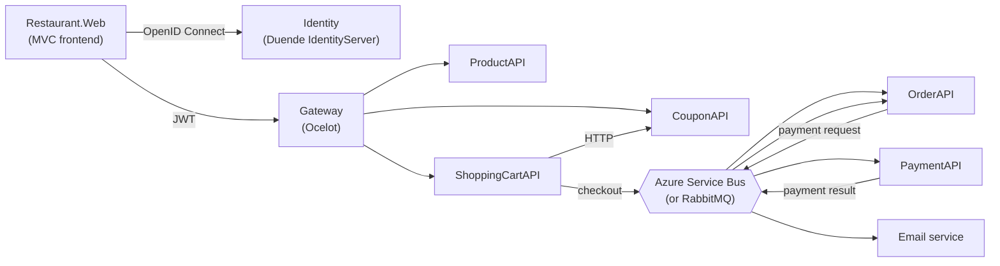

# Restaurant Microservices

**Food ordering system split into .NET 6 microservices, with an API gateway, central identity server and asynchronous messaging.**

> This is a learning project based on a course about microservices in .NET. I built it to practice service decomposition, OAuth 2.0 / OpenID Connect and message-based communication between services.


## Architecture



| Service | Responsibility |
| --- | --- |
| `Restaurant.Web` | MVC frontend; signs users in with OpenID Connect and calls the APIs with a bearer token |
| `Restaurant.Services.Identity` | Duende IdentityServer with ASP.NET Core Identity; issues access tokens |
| `Restaurant.GatewaySolution` | Ocelot API gateway; routes requests to the services and validates JWTs |
| `Restaurant.Services.ProductAPI` | Menu items (CRUD) |
| `Restaurant.Services.ShoppingCartAPI` | User carts; applies coupons and publishes the checkout message |
| `Restaurant.Services.CouponAPI` | Discount coupons |
| `Restaurant.Services.OrderAPI` | Creates orders from checkout messages and updates payment status |
| `Mango.Services.PaymentAPI` | Processes payment requests (`PaymentProcessor` is a stub) and publishes the result |
| `Restaurant.Services.Email` | Listens for payment results and logs order confirmation emails |
| `Restaurant.MessageBus` | Shared library for publishing messages to Azure Service Bus |

Each service has its own SQL Server database managed with EF Core migrations. Services communicate synchronously over HTTP only where they need an immediate answer (cart → coupon); everything else goes through topics on the message bus. A RabbitMQ implementation of the same messages is included as an alternative to Azure Service Bus.

## Tech stack

- **Backend:** C#, .NET 6, ASP.NET Core Web API and MVC
- **Data:** Entity Framework Core 6, SQL Server, AutoMapper
- **Security:** Duende IdentityServer, OpenID Connect, JWT bearer authentication
- **Gateway:** Ocelot
- **Messaging:** Azure Service Bus (topics and subscriptions), RabbitMQ
- **API docs:** Swagger (Swashbuckle)

## Running locally

Requirements: .NET 6 SDK, SQL Server and an Azure Service Bus namespace (Standard tier, for topics).

1. Create the topics and subscriptions referenced in each service's `appsettings.json`.
2. Set the Service Bus connection string with User Secrets in the services that use the bus (OrderAPI, PaymentAPI, Email, ShoppingCartAPI):
   ```bash
   dotnet user-secrets set "ServiceBusConnectionString" "<connection string>" --project Restaurant.Services.OrderAPI
   ```
3. Apply the EF Core migrations for each service and start all projects (in Visual Studio: *Configure Startup Projects → Multiple startup projects*).
